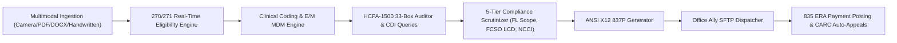

# Autonomous Medical Billing AI Engine (HIPAA-5010 & Office Ally)

Production-grade Autonomous Medical Coding & Billing Engine connecting clinical documentation (Magnolia App, Camera OCR, PDF, DOCX, Handwritten notes) to **Office Ally** clearinghouse via HIPAA 5010 ANSI X12 837P, with real-time 270/271 eligibility, 5-tier scrutiny, and 835 remittance learning.

---

## 🏛️ System Architecture



---

## 🚀 Quickstart & Local Execution

### 1. Run Multi-Agent Audit Suite
```bash
python review_audit.py
```

### 2. Run Local REST API Server (FastAPI)
```bash
python api.py
# Or with uvicorn
uvicorn api:app --reload --port 8000
```
Open **Interactive Swagger UI**: [http://localhost:8000/docs](http://localhost:8000/docs)

### 3. Run with Docker Compose
```bash
docker-compose up --build
```

---

## 📦 Core Endpoints

* `POST /api/v1/encounter/process`: Ingests clinical notes, runs eligibility, codes encounter, audits HCFA boxes, scrutinizes compliance, generates 837P, and transmits to Office Ally.
* `POST /api/v1/eligibility/check`: Real-time 270/271 patient policy active check, copay, deductible, and prior-auth requirements.
* `POST /api/v1/remittance/ingest-835`: Parses 835 ERAs (EOBs), posts payments, and drafts formal clinical appeals for CARC 97/50 denials.
* `GET /health`: Health status.

---

## 🛡️ Compliance & Security
* **HIPAA 5010 Compliant** (`005010X222A1` for 837P, `005010X221A1` for 835, `005010X279A1` for 270/271).
* **Florida Scope of Practice**: Florida Statute § 464.0123 (Autonomous APRN) & Medicare Incident-to rules.
* **FCSO Medicare MAC**: Jurisdiction N Local Coverage Determinations (LCDs).
* **NCCI PTP/MUE**: Procedure-to-Procedure bundling and Medically Unlikely Edits.
