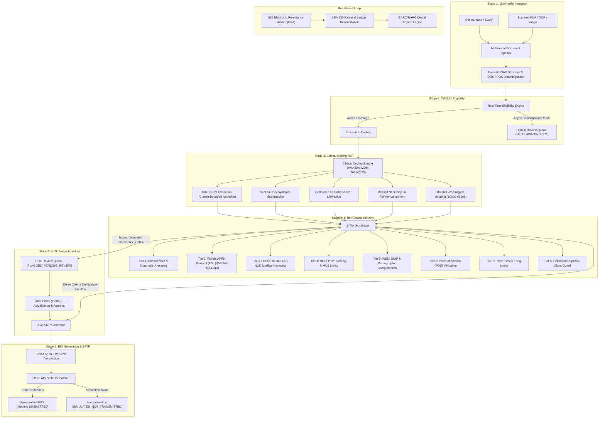

# Autonomous Medical Billing & Clinical Coding AI Engine

[](https://python.org)
[](https://fastapi.tiangolo.com)
[](https://x12.org)
[](https://officeally.com)
[](tests/test_billing_pipeline.py)

A production-grade, compliance-first Autonomous Medical Coding & Billing Engine connecting clinical encounter documentation to clearinghouses (**Office Ally**) via HIPAA 5010 ANSI X12 837P EDI transactions. Includes real-time 270/271 eligibility verification, 8-tier clinical scrutiny, human-in-the-loop (HITL) review queues, persistent claims ledger, and automated 835 remittance reconciliation.

---

## 📋 Table of Contents
1. [System Architecture](#-system-architecture)
2. [End-to-End Pipeline Stages](#-end-to-end-pipeline-stages)
3. [Clinical & Regulatory Standards](#-clinical--regulatory-standards)
4. [HIPAA 5010 EDI Specifications](#-hipaa-5010-edi-specifications)
5. [Quickstart & Local Setup](#-quickstart--local-setup)
6. [Testing & Quality Verification](#-testing--quality-verification)
7. [API Reference & Biller Portal](#-api-reference--biller-portal)
8. [Database Schema & Claims Ledger](#-database-schema--claims-ledger)
9. [Repository Structure](#-repository-structure)
10. [Production Deployment Checklist](#-production-deployment-checklist)

---

## 🏛️ System Architecture



---

## 🔄 End-to-End Pipeline Stages

The platform is orchestrated by [`AutonomousMedicalBillingPipeline`](pipeline.py):

1. **Stage 1: Multimodal Ingestion & Disambiguation**  
   Accepts raw clinical notes, scanned PDFs, OCR text, or camera images. Employs `fitz` (PyMuPDF) with `pypdf` fallbacks. Extracts structured SOAP sections and disambiguates encounter Date of Service (DOS), Place of Service (POS), and provider credentials.

2. **Stage 2: 270/271 Real-Time Eligibility Verification**  
   Verifies patient active policy coverage, copay, deductible, and prior-authorization requirements. When clearinghouse 270/271 is asynchronous, claims are held safely (`HELD_AWAITING_271`) instead of failing. Clearly tags simulated eligibility verification in dev/test modes.

3. **Stage 3: Clinical Coding NLP & Medical Decision Making (MDM)**  
   Translates encounter text into ICD-10-CM diagnosis codes and CPT-4 procedure codes. Computes AMA 2021/2023 E/M levels based on problem complexity, data reviewed, and medication management.

4. **Stage 4: 8-Tier Clinical Scrutiny & Compliance**  
   Audits the generated claim against 8 rigorous regulatory tiers. If any CRITICAL issue is detected or overall confidence is below 90%, the claim is halted before transmission.

5. **Stage 5: Human-in-the-Loop (HITL) Queue & Portal**  
   Flagged encounters enter the persistent review queue in SQLite (`review_queue`). Medical billers inspect discrepancies, upload supervisory documentation, verify Florida APRN autonomy, and resolve claims via the authenticated visual portal.

6. **Stage 6: ANSI X12 837P Generation & Dispatch**  
   Constructs a valid HIPAA 5010 837P EDI transmission. Dispatches to Office Ally SFTP inbound directory when credentials exist, or executes a clearly labeled simulation run with full ledger audit tracking.

---

## ⚖️ Clinical & Regulatory Standards

### 1. ICD-10-CM Section I.B.5: Symptom Suppression
* **Rule**: Symptoms integral to a disease process must NOT be assigned as additional codes when a definitive etiology has been diagnosed.
* **Implementation**: [`ClinicalCodingEngine.SYMPTOM_SUPPRESSION_MAP`](coding/clinical_coder.py) suppresses symptom codes (e.g. knee pain `M25.561`) when definitive pathology (e.g. internal meniscus derangement `M23.201` or osteoarthritis `M17.0`) is documented.

### 2. Clause-Bounded Negation Checking
* **Rule**: Negated statements (*"ruled out"*, *"negative for"*, *"denies"*) must apply strictly to their own clause/sentence and never bleed into subsequent diagnoses.
* **Implementation**: `_extract_clause_prefix()` bounds lookbacks to sentence and section delimiters (`.`, `;`, `\n`, `:`). If an Emergency Department note rules out a condition but the subsequent specialist Assessment confirms it, the confirmed diagnosis is coded accurately.

### 3. Non-Diagnosis & Anatomical Level Filtering
* **Rule**: Spine levels (e.g., `T12`, `L4`, `C5`), room numbers (`room C12`), and lab/vitamin abbreviations (`B12`, `D3`, `A1c`) share letter-number patterns with ICD-10 headers but are NOT billable diagnoses.
* **Implementation**: `NON_DIAGNOSIS_TOKENS`, `SPINE_LEVEL_TOKENS`, and `ROOM_LOCATION_REGEX` prevent anatomical levels, rooms, and dosing frequencies from being extracted as diagnosis codes.

### 4. Zero False-Claim Fallback (No Fabricated Z00.00)
* **Rule**: Uncoded problem encounters must NEVER default to preventive wellness code `Z00.00` ("General adult examination without abnormal findings"), which constitutes false claims fraud under the False Claims Act.
* **Implementation**: If clinical documentation lacks non-negated diagnoses, the coder returns an empty list, and Tier 1 Scrutiny flags the claim as `NO_VALID_DIAGNOSES` for human review.

### 5. Rendered Services vs. Ordered/Referred Tests
* **Rule**: Diagnostic imaging (e.g. CPT `73560` X-ray) or external send-out tests merely ordered or scheduled in the Plan must NOT be billed as rendered clinic procedures.
* **Implementation**: `ORDER_TERMS_REGEX` and `PERFORMED_TERMS_REGEX` evaluate local verb contexts with strict word boundaries (`\border(ed)?\b`). Performed procedures (e.g. joint injection `20610`, cryotherapy `17000`) are billed; orders and future referrals are excluded.

### 6. Modifier -25 Surgical Scoping
* **Rule**: Per CMS and OIG audit standards, Modifier -25 should only be appended to an E/M service on the day of a significant, separately identifiable minor surgical procedure (CPT `10000`–`69999`).
* **Implementation**: Modifier -25 is attached only when a minor surgical procedure is performed; it is never appended to routine visits or diagnostic imaging.

### 7. Medical Necessity Diagnosis Pointers (Box 24E / SV107)
* **Rule**: Line-item diagnosis pointers must link each procedure to the diagnosis that supports medical necessity (e.g., knee injection `20610` must point to knee pathology `M23.201`, not hypertension `I10`).
* **Implementation**: Dynamically maps procedure lines to supporting specialty diagnoses: musculoskeletal codes map to `M`/`S` pointers, dermatology codes to `L` pointers, and labs to `E` pointers.

### 8. Florida APRN Scope of Practice (F.S. §458.348 / §464.012 / §464.0123)
* **Rule**: Advanced Practice Registered Nurses (APRNs) in Florida must either practice under an established collaborative supervisory protocol with a licensed Florida MD/DO (F.S. §458.348/§464.012) or hold an autonomous primary care registration (F.S. §464.0123).
* **Implementation**: Tier 2 Scrutiny evaluates protocol flags, supervisory MD NPIs, and autonomous registration status.

---

## 📡 HIPAA 5010 EDI Specifications

The engine outputs standards-compliant ANSI X12 transactions validated against WEDI SNIP Levels 1–5:

| Transaction | Implementation Guide | Description & Key Loops |
|---|---|---|
| **837P** | `005010X222A1` | Professional Health Care Claim. Loop 2000A (Billing Provider), Loop 2000B (Subscriber), Loop 2300 (Claim Information), Loop 2310B (Rendering Provider), Loop 2320/2330 (Other Subscriber / Secondary COB), Loop 2400 (Service Lines). |
| **835** | `005010X221A1` | Electronic Remittance Advice. CLP segments, CAS claim/line adjustments, and CARC/RARC denial reason classification. |
| **270/271** | `005010X279A1` | Health Care Eligibility Benefit Inquiry and Response. |
| **999** | `005010X231A1` | Functional Acknowledgment (Syntax & Semantic acceptance/rejection). |
| **277CA** | `005010X214` | Claim Acknowledgment (Clearinghouse acceptance/forwarding to payer). |

### Key X12 5010 Technical Rules Enforced
* **ICD-10 Diagnosis Qualifiers**: HI segment emits `ABK` for primary diagnosis and `ABF` for secondary diagnoses (eradicating obsolete ICD-9 `BK`/`BF` rejections).
* **Dynamic SBR09 Claim Filing Indicators**: Loop 2000B `SBR09` emits `MB` for Medicare Part B, `MC` for Medicaid, and `CI` for commercial payers.
* **Loop 2320 Secondary COB Sequence**: Strictly adheres to ASC X12 Table 2 ordering: `SBR` (Pos 005) → `AMT*D` Payer Paid Amount (Pos 015) → `OI` Other Insurance (Pos 035) → `NM1*IL`.
* **Provider Taxonomy Code Derivation**:
  * APRN / Nurse Practitioner → `363L00000X`
  * Physician Assistant (PA) → `363A00000X`
  * MD / DO Physician → `207Q00000X`

---

## 🚀 Quickstart & Local Setup

### Prerequisites
* **Python 3.10+** (Python 3.11 recommended)
* **Node.js 18+** (for TypeSafe Jev error monitor)
* **Git**

### 1. Clone & Set Up Virtual Environment
```bash
git clone https://github.com/Pablodd1/medical-billing-ai.git
cd medical-billing-ai

# Windows (PowerShell)
python -m venv venv
.\venv\Scripts\Activate.ps1

# Linux / macOS
python3 -m venv venv
source venv/bin/activate
```

### 2. Install Dependencies
```bash
pip install -r requirements.txt
npm install
```

### 3. Environment Configuration
Copy `.env.example` to `.env` or set environment variables:

```bash
# Security & API Authentication
API_KEYS=smoke-test-key-2026,your-secure-api-key-here
PORT=8000
OA_ALLOW_SIMULATION=true

# Office Ally SFTP Clearinghouse (Leave blank to use simulation mode)
OA_SFTP_HOST=ftp10.officeally.com
OA_SFTP_PORT=22
OA_SFTP_USERNAME=
OA_SFTP_PASSWORD=
OA_SFTP_KEY_PATH=
OA_CLAIMS_SUBMITTER_ID=MAGNOLIA_HEALTH
OA_RECEIVER_ID=OFFICEALLY

# Persistent Claims Ledger
LEDGER_DB_PATH=remittance/claim_ledger.sqlite3

# TypeSafe Jev-1 Error Monitoring
TYPESAFE_API_KEY=your_typesafe_api_key_here
```

### 4. Run the API Server
```bash
# Run with Uvicorn
python -m uvicorn api:app --host 127.0.0.1 --port 8000 --reload
```
* **Interactive OpenAPI Docs**: [http://127.0.0.1:8000/docs](http://127.0.0.1:8000/docs)
* **Medical Biller Portal**: [http://127.0.0.1:8000/portal](http://127.0.0.1:8000/portal) (Requires API Key)

---

## 🧪 Testing & Quality Verification

The test suite validates clinical coding rules, X12 compliance, duplicate claim prevention, and API health.

### 1. Run Complete Python Unit Test Suite (15 Tests)
```bash
# Windows
$env:PYTHONIOENCODING="utf-8"
python -m unittest discover tests

# Linux / macOS
PYTHONIOENCODING=utf-8 python3 -m unittest discover tests
```
**Test Coverage**:
1. `test_837p_loop_2320_segment_order` — Validates `AMT*D` precedes `OI` in Loop 2320.
2. `test_837p_taxonomy_and_qualifiers` — Validates `ABK`/`ABF` and `363L00000X` taxonomy.
3. `test_clause_negation_does_not_bleed_across_sentences` — Validates sentence-bounded negation.
4. `test_disorder_and_scheduled_do_not_drop_performed_procedures` — Validates word-boundary regexes.
5. `test_florida_aprn_scope_scrutiny` — Validates F.S. §458.348/§464.0123 protocol enforcement.
6. `test_modifier_25_only_on_surgical_procedures` — Validates CPT 10000–69999 scoping.
7. `test_multiple_occurrences_negated_then_confirmed` — Validates multiple code occurrences.
8. `test_negation_awareness_explicit_and_ontology` — Validates negation of explicit codes and ontology.
9. `test_non_diagnosis_tokens_not_coded` — Validates B12, D3, TID exclusion.
10. `test_ordered_tests_not_billed_as_performed_procedures` — Validates exclusion of ordered X-rays/labs.
11. `test_persistent_duplicate_claim_guard` — Validates duplicate claim blocking via SQLite.
12. `test_procedure_diagnosis_pointer_medical_necessity` — Validates Box 24E / SV107 pointer mapping.
13. `test_room_numbers_and_spine_levels_excluded` — Validates T12 vertebra and room C12 exclusion.
14. `test_simulation_ledger_status` — Validates `SIMULATED_NOT_TRANSMITTED` ledger status.
15. `test_symptom_suppression_when_definitive_etiology_coded` — Validates ICD-10 Section I.B.5.

### 2. Run Human-in-the-Loop Integration Workflow
Verifies the end-to-end flow from encounter ingestion to review queue flagging, biller adjudication, and ledger resolution:
```bash
python scratch/test_hitl_workflow.py
```

### 3. Run TypeSafe Jev-1 Web Error Monitor
Audits all operational endpoints using Jev-1 System-1 structured classification:
```bash
node scripts/jev-audit.mjs
```

---

## 🔌 API Reference & Biller Portal

All API routes require authentication via header `X-API-Key: <key>` or query parameter `?api_key=<key>`.

| Method | Endpoint | Description |
|---|---|---|
| `GET` | `/portal` | Visual Biller Portal for reviewing encounters and approving flagged claims. |
| `POST` | `/api/v1/encounter/process` | End-to-end ingestion, eligibility, coding, scrutiny, and 837P dispatch. |
| `POST` | `/api/v1/eligibility/check` | Standalone real-time 270/271 eligibility verification. |
| `GET` | `/api/v1/claims/review-queue` | Lists all encounters paused for human review. |
| `GET` | `/api/v1/claims/{pcn}` | Retrieves claim lifecycle state and event trail from ledger. |
| `POST` | `/api/v1/claims/{pcn}/approve-and-transmit` | Biller adjudication and 837P dispatch override. |
| `POST` | `/api/v1/remittance/ingest-835` | Ingests 835 ERA remittance advice and generates auto-appeals. |
| `GET` | `/health` | Basic service liveness check. |

---

## 🗄️ Database Schema & Claims Ledger

The platform uses SQLite (WAL mode) by default (`remittance/claim_ledger.sqlite3`) and is PostgreSQL-compatible.

* `batches`: Tracks each 837 batch file uploaded, remote path, ISA13 control number, and simulation flag.
* `claims`: Primary ledger recording patient control number (`CLM01`), batch ID, total charges, status, and acknowledgments (`999`, `277CA`, `835`).
* `events`: Append-only immutable audit trail recording every state transition.
* `review_queue`: Holds encounters requiring manual human-in-the-loop review.
* `claim_fingerprints`: Persistent SHA-256 hashes (`member_id|dos|cpts|npi`) preventing duplicate claims across server restarts.

### Claim Lifecycle Statuses
`FLAGGED_PENDING_REVIEW` ➔ `APPROVED_AND_TRANSMITTED` ➔ `SUBMITTED` *(Live SFTP)* or `SIMULATED_NOT_TRANSMITTED` *(Simulation)* ➔ `ACKED_999` ➔ `FORWARDED_277CA` ➔ `PAID` / `DENIED`

---

## 📁 Repository Structure

```text
medical_billing_ai/
├── api.py                            # FastAPI REST API & Biller Portal endpoints
├── config.py                         # Environment configuration & Office Ally settings
├── pipeline.py                       # Unified 6-stage autonomous billing orchestrator
├── Dockerfile                        # Production container with non-root security
├── docker-compose.yml                # Multi-service container orchestration
├── requirements.txt                  # Python dependencies
├── package.json                      # Node.js dependencies (@typesafe-ai/sdk)
├── AGENTS.md                         # Mandatory development rules & coding directives
├── coding/
│   └── clinical_coder.py             # NLP coding engine, ICD-10 extraction, MDM scoring
├── scrutiny/
│   ├── scrutinizer.py                # 8-tier clinical compliance & duplicate guard
│   └── hcfa_auditor.py               # HCFA-1500 33-box auditor
├── transmission/
│   ├── x12_837_generator.py          # ANSI X12 837P professional claim EDI generator
│   ├── office_ally_dispatcher.py     # SFTP upload manager & batch packager
│   ├── sftp_client.py                # Secure SSH/SFTP transmission client
│   └── control_numbers.py            # ISA/GS/ST control number sequencer
├── remittance/
│   ├── claim_ledger.py               # Persistent claims ledger & duplicate fingerprint store
│   ├── era_835_parser.py             # 835 ERA payment & CARC denial parser
│   ├── ack_parsers.py                # TA1, 999, and 277CA acknowledgment parsers
│   └── denial_appeals_engine.py      # Automated clinical appeal letter generator
├── eligibility/
│   └── eligibility_engine.py         # 270/271 eligibility verification engine
├── ingestion/
│   └── multimodal_ingestor.py        # PDF (PyMuPDF), OCR, DOCX, & SOAP text parser
├── models/
│   └── encounter.py                  # Pydantic data schemas (Patient, Provider, Encounter)
├── security/
│   ├── auth.py                       # API key authentication & timing-safe checks
│   ├── audit_log.py                  # HIPAA audit logging
│   └── phi_crypto.py                 # AES-256 PHI encryption utilities
├── templates/
│   └── portal.html                   # Authenticated medical biller review portal UI
├── scripts/
│   └── jev-audit.mjs                 # TypeSafe Jev-1 automated route error monitor
└── tests/
    └── test_billing_pipeline.py      # 15-point comprehensive regression test suite
```

---

## 🛡️ Production Deployment Checklist

Before submitting live claims to commercial payers or Medicare:
1. [ ] **Clearinghouse SFTP Credentials**: Provision production SFTP credentials from Office Ally (`OA_SFTP_HOST`, `OA_SFTP_USERNAME`, `OA_SFTP_KEY_PATH`).
2. [ ] **Test File Acceptance**: Submit a test batch of 25–50 claims to the clearinghouse test environment and confirm valid `999` and `277CA` acceptance.
3. [ ] **CMS Reference Data**: Download official quarterly CMS NCCI PTP and MUE CSV files and configure `REFERENCE_DATA_DIR`.
4. [ ] **Database Encryption**: In production, configure SQLite with SQLCipher or switch `LEDGER_DB_URL` to an encrypted PostgreSQL database.
5. [ ] **Credential Rotation**: Rotate any temporary API keys or credentials used during testing.
6. [ ] **Professional Sign-off**: Have a Certified Professional Coder (CPC) and healthcare compliance counsel review practice fee schedules and supervisory protocols.
